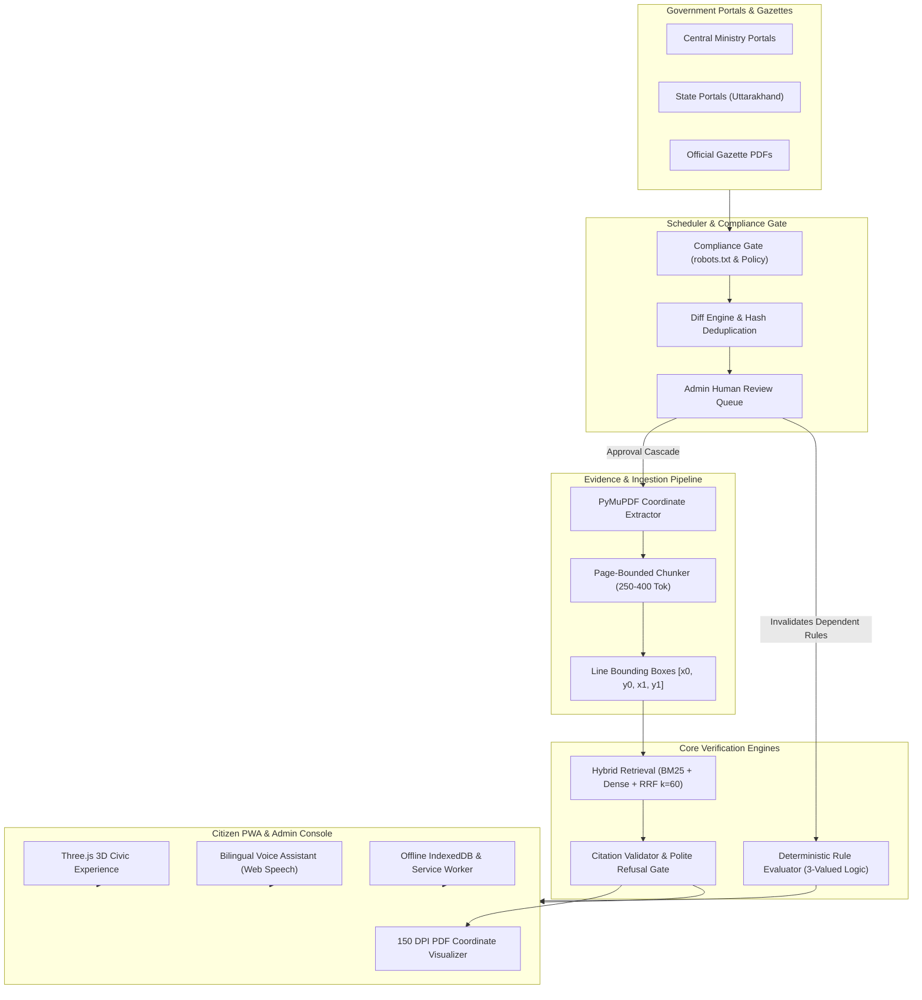

# Yojana Sahayak (योजना सहायक)

> **Bilingual, Evidence-Grounded Government Scheme Discovery & Deterministic Eligibility Assistant**  
> *INNOVISTA Hackathon — Problem Statement 03*

---

## 🏛️ Executive Summary

Millions of Indian citizens struggle to navigate complex government welfare schemes due to fragmented portals, outdated information, and generative AI systems that hallucinate eligibility rules.

**Yojana Sahayak** solves this with an institutional-grade, zero-hallucination platform that combines:
1. **Deterministic Eligibility Rules Engine**: Pure Python 3-valued Kleene logic (`TRUE`, `FALSE`, `UNKNOWN`) with statutory disqualification precedence and human-reviewed rule condition trees. **The LLM never computes eligibility.**
2. **Point-Accurate PDF Coordinate Grounding**: Extracts word and line bounding boxes `[x0, y0, x1, y1]` using PyMuPDF. Every AI answer and active rule links directly to the official government gazette with saffron coordinate highlights on a 150 DPI page visualizer.
3. **Automated Compliance & Discovery Pipeline**: Per-source compliance gates (`robots.txt`, written authorization enforcement), content-addressable storage, line-by-line diff engine, and an automated rule invalidation cascade.
4. **Resilient Citizen Experience**: Interactive Three.js 3D Dharma Chakra civic emblem, offline Progressive Web App (PWA) with client-side IndexedDB, bilingual voice assistant (Hindi & Indian English), and verified email deadline alerts.

---

## 📐 Architecture & Key Guarantees



### 🔒 Core Guarantees
- **Zero Hallucination Guarantee**: Every chat citation must reference an existing chunk in the top retrieval context. Invented citation tags (e.g. `[C99]`) are stripped and penalized. Unsupported or absurd queries trigger polite bilingual refusal with zero citations.
- **Strict Invalidation Gate**: Approving a changed gazette immediately marks all active dependent rules as `needs_review` and removes them from public evaluation until re-approved by a human officer.
- **Privacy Standard**: Zero PII collected or logged in platform analytics. Sliding-window rate limiting (120 req/min default, 60 req/min strict) protects public endpoints.

---

## 🛠️ Technology Stack

| Layer | Technologies |
|---|---|
| **Backend** | Python 3.11, FastAPI, SQLAlchemy (Async), Alembic, Pydantic v2 |
| **PDF & Vision** | PyMuPDF (`fitz`), Pillow, Content-Addressable Storage (SHA-256) |
| **Information Retrieval** | Hybrid BM25 (Devanagari segmented) + Dense N-Gram Vectors + Reciprocal Rank Fusion ($k=60$) |
| **LLM & Inference** | Groq API (`llama-3.3-70b-versatile`), Deterministic Grounded Provider (Offline fallback) |
| **Scheduler** | APScheduler 3.x, Dedicated single-instance lock file (`SchedulerProcessLock`) |
| **Frontend** | React 18, TypeScript, Vite, Tailwind CSS, Three.js, Lucide Icons, Canvas Confetti |
| **PWA & Offline** | Service Worker (App Shell caching), Client-side IndexedDB, Web Speech API |
| **Deployment** | Docker, Render (`render.yaml`), Netlify (`netlify.toml`) |

---

## 🚀 Quick Start Guide

### Prerequisites
- Python 3.11+
- Node.js 18+ and `npm`

### 1. Repository Setup & Dependencies
```bash
# Clone the repository
git clone <repo-url>
cd yooznnnan

# Install backend dependencies
pip install -r backend/requirements.txt

# Install frontend dependencies
cd apps/web
npm install
cd ../..
```

### 2. Environment Configuration
Copy the sample environment file:
```bash
cp .env.example .env
```
*(Optional: set `GROQ_API_KEY` in `.env` for cloud LLM inference. If omitted, the system automatically uses the Deterministic Grounded Provider).*

### 3. Start Backend Services
```bash
# Start FastAPI server on port 8000
python -m uvicorn backend.app.main:app --host 127.0.0.1 --port 8000 --reload
```

In a separate terminal, start the dedicated scheduler daemon (optional for local background discovery):
```bash
python -m backend.app.scheduler.run
```

### 4. Start Frontend Application
```bash
cd apps/web
npm run dev -- --host 127.0.0.1 --port 5173
```
Open your browser at `http://127.0.0.1:5173`.

---

## 🧪 Comprehensive Verification Suite

### Automated Backend Tests (46/46 Passed)
```bash
python -m pytest backend/tests/ -v
```
Test suites include:
- `test_rag_benchmark_40.py`: 40-question benchmark across English numeric, Hindi cross-lingual, boundary checks, and absurd refusals.
- `test_deterministic_eligibility.py`: Kleene logic operators, 25 synthetic profiles, and multi-factor ranking.
- `test_rules_and_invalidation.py`: Active rule provenance, quote verification, and source change invalidation cascade.
- `test_pdf_ingestion.py`: Point-accurate bounding boxes, page-bounded chunking, and diagnostic renderer.
- `test_hybrid_retrieval_and_rag.py`: Hard SQL verification gate, citation validator, and polite refusal.
- `test_compliance_and_scheduler.py`: Source registry compliance gate, myScheme restrictions, and scheduler controls.
- `test_reminders_and_analytics.py`: Double opt-in reminders, zero PII telemetry, and audit exports.

### Frontend Production Build (0 Errors)
```bash
cd apps/web
npm run build
```

---

## 🗺️ Application Routes

### Citizen Experience (`apps/web`)
- `/`: Landing page with Three.js 3D Dharma Chakra emblem, quick search, and feature highlights.
- `/app/discover`: Search and filter central and state welfare schemes.
- `/app/chat`: Bilingual RAG assistant with inline `[C1]` citation pills and slide-out evidence drawer.
- `/app/eligibility`: Multi-step eligibility questionnaire with "Not Sure" handling.
- `/app/recommendations`: Ranked scheme recommendations with match score, eligibility status badge, and full explainability.
- `/app/schemes/:schemeId`: Statutory scheme rules, application checklist, and verified gazettes.
- `/app/saved`: Offline-first saved schemes and checklist progress stored in IndexedDB.
- `/how-it-works`: Civic architecture guide and zero-hallucination manifesto.

### Admin Governance Console (`/admin`)
- `/admin/sources`: Source compliance registry, robots.txt inspection, and policy review.
- `/admin/discovery`: APScheduler telemetry, active cron jobs, and Run Now discovery trigger.
- `/admin/review-queue`: Content-addressable review console with line-by-line diffing.
- `/admin/documents`: PDF ingestion dashboard with 150 DPI coordinate spot-check visualizer.
- `/admin/rules`: Structured eligibility condition tree builder and invalidation simulator.
- `/admin/freshness`: Source staleness monitor and overdue sync alerts.
- `/admin/audit`: Compliance event audit trail with JSON and CSV exports.

---

## 🏆 Innovation & Impact (INNOVISTA PS-03)

1. **Separation of Concerns**: Generative AI translates and formats language; deterministic rule engines make statutory decisions.
2. **Every Digit Grounded**: Clicking a grant amount (e.g. ₹6,000 in PM-KISAN) opens the actual official gazette page with the exact paragraph highlighted in saffron.
3. **No Stale Data**: The moment a ministry amends an income threshold, the system flags affected rules and hides unverified claims immediately.
4. **Offline Resilience for Rural Bharat**: Works offline via IndexedDB and Service Worker when connectivity drops in remote panchayats.

---

## 📄 License

Developed for the INNOVISTA Hackathon. All official government scheme guidelines and gazettes are public records of their respective ministries.

