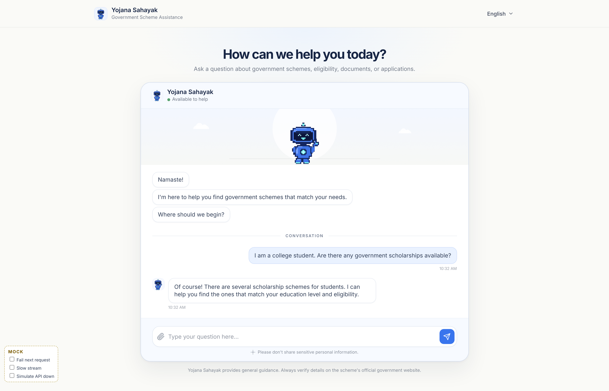
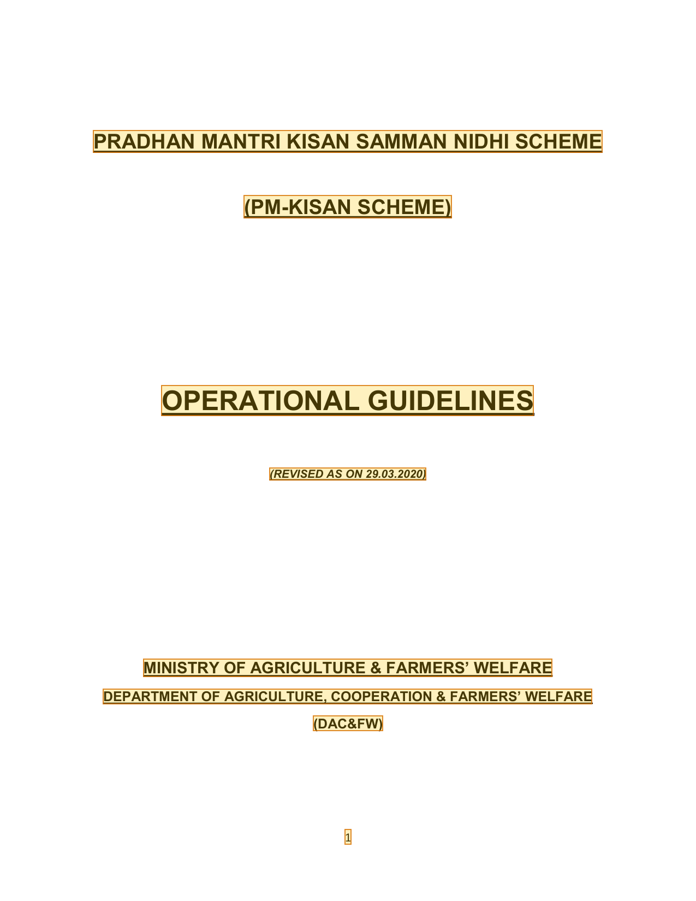
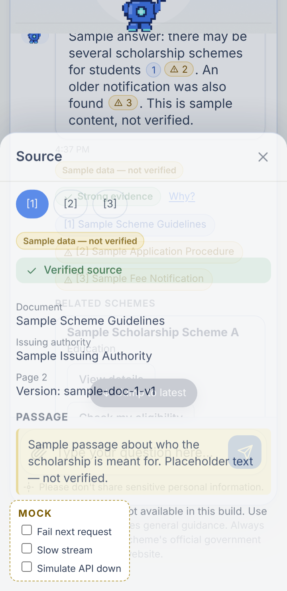
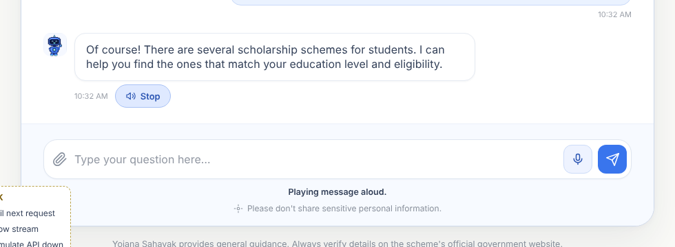
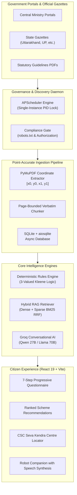

# 🏛️ Yojana Sahayak (योजना सहायक)

> **Bilingual, Evidence-Grounded Government Scheme Discovery & Deterministic Eligibility Platform**  
> *Connecting Indian citizens with central and state welfare initiatives through authentic official gazettes, zero-hallucination deterministic logic, and conversational voice AI.*

[](https://yooznnnan.onrender.com/)
[](https://react.dev/)
[](https://fastapi.tiangolo.com/)
[](https://python.org/)
[](LICENSE)

---

## 🌐 Live Deployments

* **Live Cloud Application (Render):** [https://yooznnnan.onrender.com/](https://yooznnnan.onrender.com/)
* **Interactive API Documentation:** [https://yooznnnan.onrender.com/docs](https://yooznnnan.onrender.com/docs)
* **API Health Status:** [https://yooznnnan.onrender.com/health](https://yooznnnan.onrender.com/health)

---

## 📸 Platform Interface & Screenshots

### 1. Grounded AI Scheme Companion (Dual Simple & Advanced Modes)
Interactive conversational assistant with bilingual support (Hindi & English), hydrated interactive scheme cards, suggested action chips, and real-time navigation:



---

### 2. Point-Accurate Gazette Coordinate Grounding (PyMuPDF)
Every benefit amount, qualification threshold, and mandatory document is grounded in official ministry gazettes with exact `[x0, y0, x1, y1]` bounding-box coordinates highlighted on a 150 DPI page visualizer:



---

### 3. Mobile Evidence Sheet & Statutory Audit Trail
Citizens can inspect the exact legal clauses and ministry provenance on mobile or desktop before applying:

| Mobile Evidence Inspection | Live Voice Interaction & Audio Synthesis |
| :---: | :---: |
|  |  |

---

## 💡 The Core Problem & Architectural Guarantee

Millions of Indian citizens struggle to access welfare schemes due to scattered portals, bureaucratic jargon, and generative AI systems that **hallucinate fake eligibility rules or incorrect income ceilings**.

### The Yojana Sahayak Guarantee:
* **The LLM never computes eligibility.** Language models are strictly used to translate, summarize, and guide citizens in natural Hindi or English.
* **Deterministic Rules Engine:** Pure Python condition trees evaluate qualification using 3-valued Kleene logic (`ELIGIBLE`, `LIKELY_ELIGIBLE`, `NEED_INFO`).
* **Zero-Hallucination Citations:** Every claimed benefit (such as ₹6,000/year under PM-KISAN or ₹5 Lakh under Ayushman Bharat) links directly to the official government gazette PDF.

---

## 📐 System Architecture



---

## 🌟 Key Features

### 1. Citizen Portal
* **7-Step Progressive Eligibility Assessment:** Guided evaluation across *Personal, Residential, Financial, Employment, Agricultural, Education,* and *Document Identification* with explicit "Not sure right now" handling.
* **Personalized Recommendations:** Match scores, eligibility status badges, and prioritized welfare initiatives.
* **CSC & Jan Seva Kendra Locator:** OpenStreetMap & Leaflet geolocation search for finding nearby verified assistance centres.
* **Voice AI Robot Companion:** Conversational assistant with audio frequency visualizer, natural speech synthesis (TTS), and speech recognition (STT) in Hindi and English.
* **Offline-First Resilience:** Client-side IndexedDB caching for browsing saved schemes and application checklists without active internet.

### 2. Admin Governance Console
* **Source Compliance Registry:** Real-time `robots.txt` compliance verification and manual crawling policy locks.
* **Discovery Jobs & Telemetry:** APScheduler monitoring with live heartbeat, PID lock verification, and manual discovery triggers.
* **Review Queue & Diff Engine:** Content-addressable review console with line-by-line diffing for detected government policy amendments.
* **Rule Invalidation Cascade:** Automatically marks affected rules as stale when a ministry updates guidelines.
* **Audit Trail:** JSON and CSV exportable compliance event log.

---

## 🛠️ Technology Stack

| Layer | Technologies |
| :--- | :--- |
| **Frontend** | React 19, TypeScript, Vite, Custom Design Tokens (`glass-card`, responsive CSS Grid, zero-flash theme engine), Lucide React, Leaflet |
| **Backend API** | Python 3.11, FastAPI, Uvicorn (standard), Pydantic V2 |
| **Data & Persistence** | SQLite with `aiosqlite` & `SQLAlchemy[asyncio]`, Alembic migrations |
| **Document Processing** | PyMuPDF (fitz), Leptonica, Tesseract OCR, Pillow |
| **Search & Retrieval** | Hybrid Dense + Sparse BM25 Reciprocal Rank Fusion (RRF), ChromaDB vector indexes |
| **Conversational AI** | Groq API (`qwen/qwen3.8-27b` / `openai/gpt-oss-120b`), Web Audio API |
| **Deployment** | Multi-stage Docker, Render, Vercel, Docker Compose |

---

## 🚀 Quick Start Guide

### Option 1: Local Development

#### 1. Backend Setup
```bash
# Clone the repository
git clone https://github.com/priyanshubishtme/yooznnnan.git
cd yooznnnan

# Create and activate virtual environment
python -m venv .venv
source .venv/bin/activate  # On Windows: .venv\Scripts\activate

# Install Python dependencies
pip install -r backend/requirements.txt

# Start backend server
python -m uvicorn backend.app.main:app --host 127.0.0.1 --port 8005 --reload
```

#### 2. Frontend Setup
```bash
cd apps/web
npm install
npm run dev -- --host 127.0.0.1 --port 5173
```
Open **`http://127.0.0.1:5173`** in your browser.

---

### Option 2: Turnkey Docker Deployment

Build and run the entire full-stack application (frontend + backend) in a single container:

```bash
# Build and run with Docker Compose
docker compose up -d --build

# Inspect container logs
docker compose logs -f
```
The application will be accessible at **`http://localhost:8005`**.

---

### Option 3: Deploy to Cloud (Render & Vercel)

* **Render (All-in-One Container):**
  1. Create a new **Web Service** on [render.com](https://render.com) and link this repository.
  2. Select **Docker** as the runtime.
  3. Add environment variable: `GROQ_API_KEY=your_key_here` and `APP_ENV=production`.
  4. Set Health Check path to `/health`.
* **Vercel (Split Frontend):**
  1. Create a new project on [vercel.com](https://vercel.com).
  2. Set Root Directory to `apps/web`.
  3. Deploy! The included `vercel.json` automatically proxies `/api/*` requests to your live Render backend without CORS issues.

---

## 🧪 Verification & Testing

```bash
# Run full backend unit and integration test suite (59 passing tests)
pytest backend/tests/ -v

# Run production frontend TypeScript and Vite build verification
npm --prefix apps/web run build
```

---

## 📚 Complete Technical Documentation

| Document | Description |
| :--- | :--- |
| **[Architecture Guide](docs/ARCHITECTURE.md)** | Deep dive into 3-valued Kleene logic, system design, and security layers. |
| **[Production Deployment](docs/DEPLOYMENT.md)** | Multi-stage Docker packaging, Render setup, and Vercel edge proxying. |
| **[Local Setup Manual](docs/LOCAL_SETUP.md)** | Step-by-step developer onboarding and environment configuration. |
| **[RAG Pipeline Deep Dive](docs/RAG_PIPELINE.md)** | Hybrid search mechanics, Reciprocal Rank Fusion (RRF), and PDF coordinate indexing. |
| **[Admin Console Operations](docs/ADMIN_GUIDE.md)** | Guidance on discovery runs, crawler scheduling, and review queue management. |
| **[Environment Variables](docs/ENVIRONMENT_VARIABLES.md)** | Comprehensive dictionary of all configurable runtime variables. |
| **[Security & Compliance](docs/SECURITY.md)** | Audit trails, data privacy, and ethical compliance with government sources. |
| **[Troubleshooting Guide](docs/TROUBLESHOOTING.md)** | Common issues, port diagnostics, and resolution steps. |

---

## 📄 License & Attribution

Developed for the **INNOVISTA Hackathon — Problem Statement 03**.  
All official government scheme guidelines, welfare policies, and gazettes are public records of their respective ministries and state departments.
